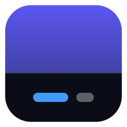
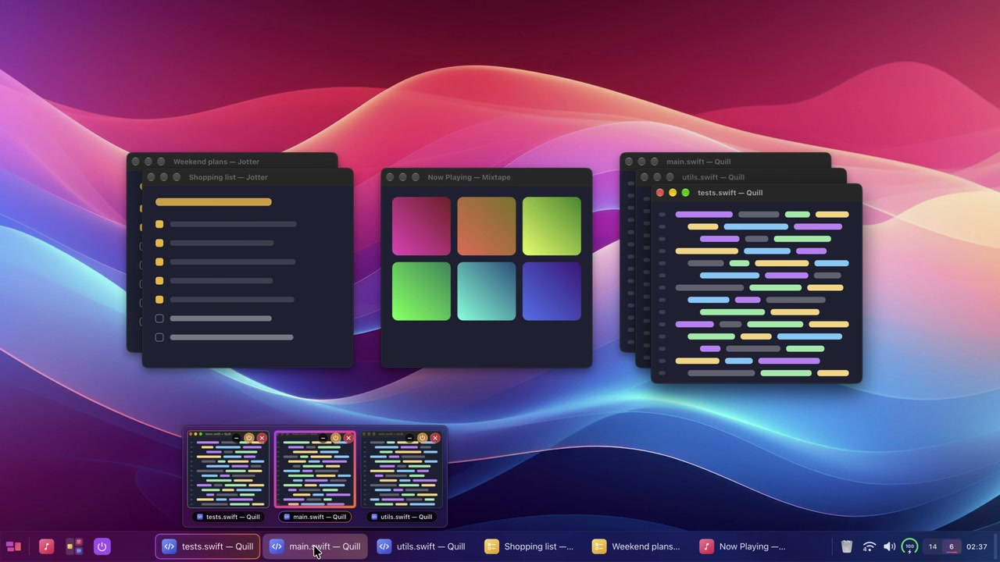
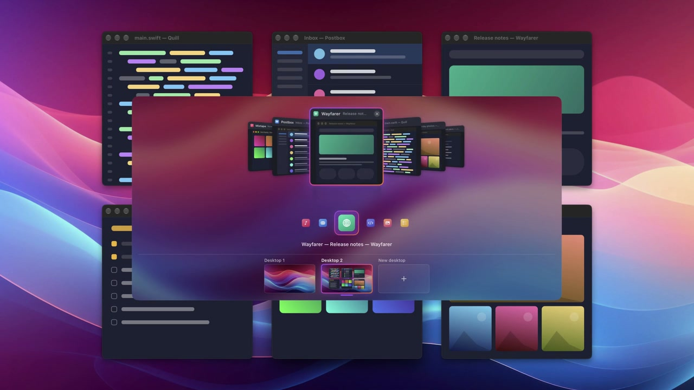
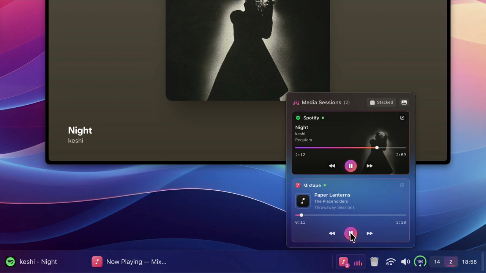
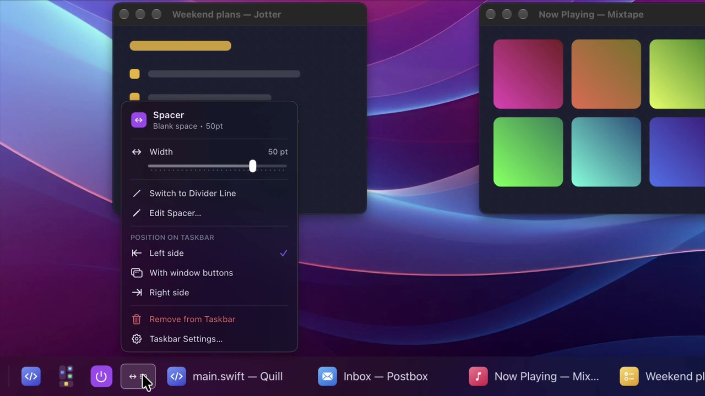
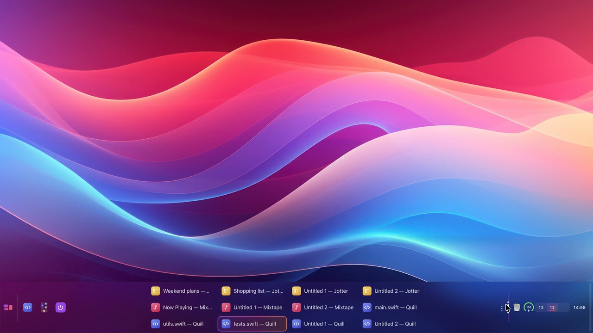

  
  <h1>TaskBay</h1>
  
<strong>Modern, native macOS taskbar</strong>

  

    <a href="https://gettaskbay.com">Website</a> ·
    <a href="https://github.com/gettaskbay/taskbay/releases">Releases</a> ·
    <a href="https://gettaskbay.com/feedback?type=feature">Feature Request</a> ·
    <a href="https://gettaskbay.com/feedback?type=issue">Report an Issue</a> ·
    <a href="https://gettaskbay.com/faq">FAQ</a> ·
    <a href="https://gettaskbay.com/support">Support</a>
  

  
macOS 14.0 Sonoma or later · Apple Silicon &amp; Intel · Runs locally with no telemetry

 

---

## Highlights

- **Per-window taskbar buttons:** Give every open window its own button alongside pinned apps, grouped stacks, and recent-document jump lists.
- **Live previews and Peek:** Hover any taskbar button for live thumbnail previews with quick Minimize, Close, and Quit actions, or keep a live window floating on top.
- **Visual window switcher:** Replace standard `⌘-Tab` switching with a keyboard-driven Cover Flow and desktop Spaces switcher.
- **System tray and interactive flyouts:** Access calendar events, multi-session media controls, Wi-Fi networks, Bluetooth battery levels, volume, and Trash status directly from the taskbar.
- **Flexible edges and styling:** Place TaskBay on the bottom, top, left, or right edge of one display or all displays, with auto-hide, multi-row scaling, and frosted glass presets.

---

## Gallery

| Window Switcher &amp; Spaces | Multi-Session Media Flyout |
| :---: | :---: |
|  |  |
| **Pinned Groups, Links &amp; Spacers** | **Multi-Row Sizing &amp; Tray Divider** |
|  |  |

---

## Installation

1. Download the latest `TaskBay.dmg` from [Releases](https://github.com/gettaskbay/taskbay/releases) or [gettaskbay.com](https://gettaskbay.com).
2. Drag **TaskBay** into **Applications**.
3. Open **TaskBay** and follow the onboarding walkthrough to grant **Accessibility** access.

**Requirements:** macOS 14.0 (Sonoma) or later on Apple Silicon or Intel.

---

## Permissions

TaskBay inspects your Mac locally and makes no analytics or tracking connections.

| Permission | Status | Purpose |
| :--- | :--- | :--- |
| **Accessibility** | Required | List open windows, focus, minimize, close, move/resize, and read Dock badges |
| **Screen Recording** | Optional | Live window hover previews, Peek, and Always-on-Top window mirrors |
| **Calendars** | Optional | Display upcoming calendar events in the tray flyout |
| **Location Services** | Optional | Required by macOS to show current and nearby Wi-Fi network names |
| **Bluetooth** | Optional | Show battery levels for connected audio accessories in the Sound flyout |
| **Automation** | Optional | Media transport controls, Trash empty, and sleep/restart/log-out actions |
| **Full Disk Access** | Optional | Display exact Trash item counts and size |

---

## Licence, Privacy &amp; Feedback

- **Licence:** 14-day free trial with full features, no card required; **$15 one-time** purchase for up to 3 Macs with all updates included. See [Terms &amp; Licence](https://gettaskbay.com/terms).
- **Privacy:** Zero telemetry or accounts. Full details in the [Privacy Policy](https://gettaskbay.com/privacy) and [FAQ](https://gettaskbay.com/faq).
- **Feedback:** [Request a feature](https://gettaskbay.com/feedback?type=feature) or [Report an issue](https://gettaskbay.com/feedback?type=issue) on the Feedback board (no account needed).
- **Support:** [gettaskbay.com/support](https://gettaskbay.com/support) or [support@gettaskbay.com](mailto:support@gettaskbay.com)
